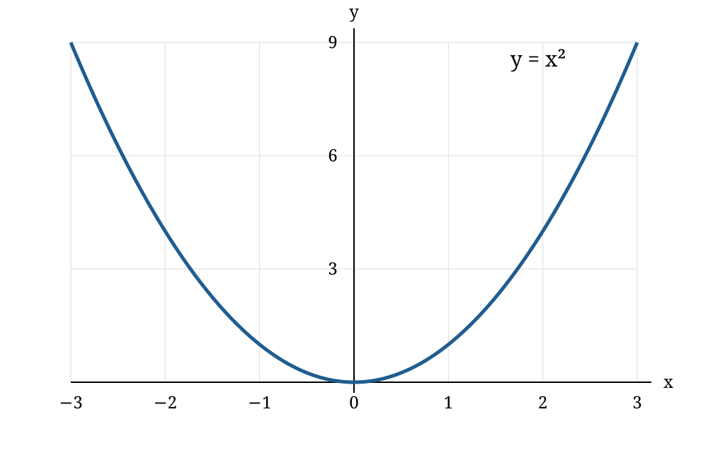

# How can visual blocks help explain retry policies?

- **Definitions**
  - **Attempt** - one execution of an operation. {#attempt}
  - **Retry** - another attempt after a failure. {#retry}
  - **Backoff** - a delay before another attempt. {#backoff}
- **Comparison.** These invented policies differ in their delays between attempts. {#comparison}

  | Policy | First delay | Second delay | Maximum retries |
  | --- | ---: | ---: | ---: |
  | Immediate | 0 seconds | 0 seconds | 2 |
  | Fixed | 1 second | 1 second | 2 |
  | Increasing | 1 second | 2 seconds | 2 |

  - The values illustrate table rendering rather than report measured service behavior.
- **Image.** The curve shows the function `y = x²` over the interval `[-3, 3]`. {#curve}

  

  - The image's natural dimensions are 1000 by 640 pixels.
  - The Full size button removes the default 200-pixel height limit.
- **Flow.** A failed attempt waits before a retry while attempts remain. {#flow}

  ```mermaid
  flowchart TD
    A[Make an attempt] --> B{Succeeded?}
    B -->|Yes| C[Return the result]
    B -->|No| D{Attempts remain?}
    D -->|Yes| E[Wait for backoff]
    E --> A
    D -->|No| F[Return the failure]
  ```

  - The [comparison table](#comparison) supplies illustrative choices for the wait.
- **Sequence.** This caller receives a result after one failed attempt and one successful retry. {#sequence}

  ```mermaid
  sequenceDiagram
    participant Caller
    participant Service
    Caller->>Service: First attempt
    Service-->>Caller: Failure
    Note over Caller: Wait for backoff
    Caller->>Service: Retry
    Service-->>Caller: Result
  ```

  - This diagram shows one path through the [retry flow](#flow).
-  {#image-only}
